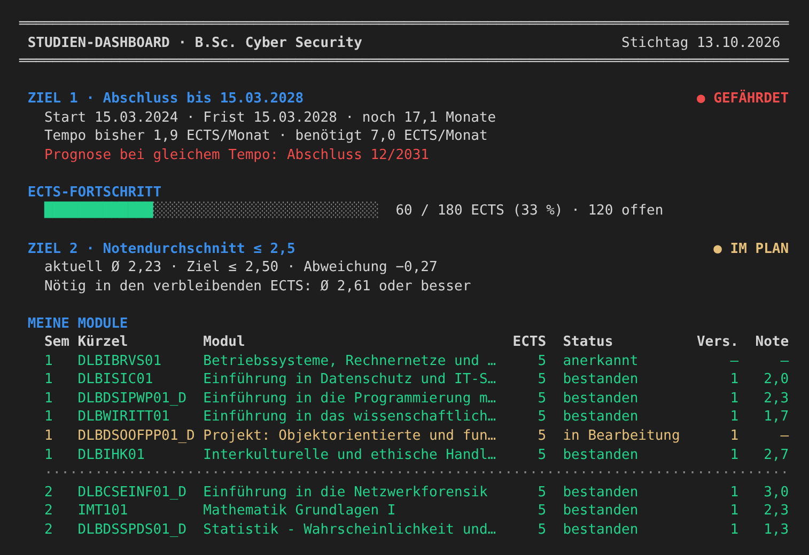

# Studien-Dashboard

Prototyp eines Kommandozeilen-Dashboards zur Überwachung des eigenen Studienfortschritts im
B.Sc. Cyber Security (IU Internationale Hochschule). Entstanden im Portfolio-Kurs
*Projekt: Objektorientierte und funktionale Programmierung mit Python* (DLBDSOOFPP01_D).



## Überwachte Ziele

| Ziel | Bewertung (Ampel) |
|---|---|
| **1 – Abschluss bis 15.03.2028** | Bisheriges Lerntempo (ECTS/Monat seit Studienbeginn) im Vergleich zum benötigten Tempo bis zur Frist, dazu eine Prognose des Abschlussdatums |
| **2 – Notendurchschnitt ≤ 2,5** | ECTS-gewichteter Durchschnitt aller bestandenen, benoteten Module im Vergleich zum Zielwert, dazu der in den verbleibenden ECTS nötige Durchschnitt |

Zusätzlich zeigt das Dashboard alle Module mit Status, Versuchen und Note sowie automatisch
abgeleitete nächste Schritte. Über das Menü lassen sich neue Prüfungsergebnisse erfassen.

## Schnellstart (Windows)

Voraussetzung: Python 3.10 oder neuer (getestet mit 3.14). Es werden **keine** externen Pakete benötigt.

```powershell
cd iu-studien-dashboard
py main.py
```

Unter macOS/Linux: `python3 main.py`.

| Option | Wirkung |
|---|---|
| `--nur-anzeigen` | Dashboard ausgeben und ohne Menü beenden |
| `--stichtag 2026-10-13` | Berechnung zu einem festen Stichtag statt zu heute |
| `--datei pfad.json` | andere Datendatei verwenden |
| `--ohne-farbe` | Ausgabe ohne Farben |

Tests ausführen: `py -m unittest -v`

## Architektur

Schichtenmodell; jede Schicht hängt nur von den darunterliegenden ab, die Domain von keiner.

```
main.py                     Startskript (Versionsprüfung)
dashboard/
  app.py                    DashboardApp – erzeugt und verbindet alle Objekte, Menüschleife
  view/                     DashboardView – Textausgabe, Benutzereingaben
  controller/               DashboardController – Ablaufsteuerung, Aufbau der DTOs
  dto/                      DashboardDatenDTO, ModulZeileDTO, ZielDTO
  service/                  FortschrittService, NotenService – objektübergreifende Berechnungen
  repository/               StudiengangRepository (abstrakt), JsonStudiengangRepository
  domain/                   Studiengang, Semester, Modul, Pruefungsleistung,
                            Ziel (abstrakt), Fristziel, Notenziel, Kennzahlen, Enums
daten/studium.json          Studiendaten
tests/                      Unit-Tests (unittest)
```

Wesentliche Entwurfsentscheidungen:

* **Validierung zur Laufzeit:** Typannotationen erzwingen nichts. Fachliche Regeln (zulässige Noten,
  positive ECTS, Versuchsreihenfolge) prüfen deshalb die Konstruktoren und Methoden selbst. Das gilt auch
  beim Laden der JSON-Datei.
* **Komposition Modul–Prüfungsleistung:** Prüfungsleistungen sind unveränderlich (`frozen`), werden nur vom
  Modul erzeugt und nur als `tuple` herausgegeben. Externe Referenzen können das Modul nicht verändern.
* **Polymorphie:** `Fristziel` und `Notenziel` implementieren die abstrakte Methode `Ziel.bewerte()` jeweils
  eigenständig.
* **Persistenz:** Module werden einmal gespeichert und von Semestern per Kürzel referenziert. So bleibt die
  Aggregation beim Laden erhalten. Gespeichert wird atomar (temporäre Datei, dann ersetzen).

## Datenpflege

`daten/studium.json` enthält **fiktive Beispieldaten**: Studiengang, Ziele, Module mit Prüfungsversuchen und die
Semesterzuordnung laut Vollzeit-Studienablaufplan FS-BACSD-01; die Noten sind frei erfunden. Eigene Daten legt man
unter `daten/privat/studium.json` ab (per `.gitignore` von der Versionsverwaltung ausgeschlossen) und startet mit
`py main.py --datei daten/privat/studium.json`. Prüfungsarten werden mit ihrem Enum-Namen angegeben,
z. B. `"KLAUSUR"`, `"PORTFOLIO"` oder `"FALLSTUDIE"`. Neue Ergebnisse trägt man am einfachsten über
Menüpunkt 2 ein.

## Autor

Ridvan Öztürk – IU Internationale Hochschule, B.Sc. Cyber Security
